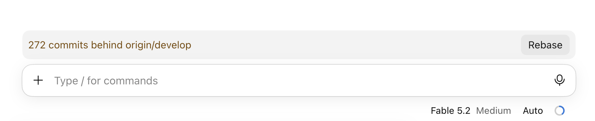

# rebase-button

A Claude Code mod that shows a band above the prompt when your branch is behind trunk, with a **Rebase** button.



- Checks every 60 seconds and after each turn; fetches trunk at most every 5 minutes.
- Trunk is `origin/HEAD`, or `origin/main` when that isn't set.
- Rebases with `--autostash`. It won't touch a rebase you already have in progress. If the rebase hits conflicts, it aborts so your branch is never left mid-rebase, then offers **Merge and let Claude fix**: it merges trunk and asks Claude to resolve the conflicts.

## Install

At the prompt of a terminal session:

```
/plugin install rebase-button --marketplace mvwi/cc-mod-rebase-button
```

Answer `y` to add the marketplace, then pick a scope.

From a shell:

```bash
claude plugin install rebase-button --marketplace mvwi/cc-mod-rebase-button
```

In the desktop app, where `/plugin` does not run: click + next to the prompt box, then Plugins, Add marketplace with `mvwi/cc-mod-rebase-button`, then Add plugin.

### Without installing a plugin

```bash
git clone https://github.com/mvwi/cc-mod-rebase-button ~/.claude/mods/rebase-button
```

Then add `~/.claude/mods/rebase-button` to `CLAUDE_CODE_PLUGIN_DIRS` under `env` in `~/.claude/settings.json` (join several paths with `:`) and restart Claude Code. Update with `git pull`.

## License

[MIT](LICENSE)
